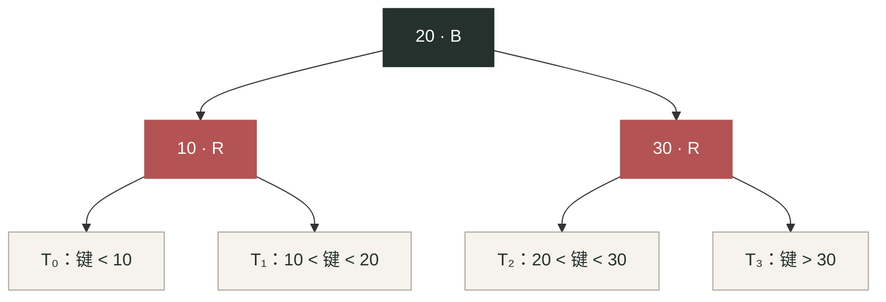

# 红黑树（Red–Black Tree）

学习入口：[[00-索引/红黑树路线图|红黑树路线图]]；练习入口：[[05-题单/Codeforces/红黑树题单|Codeforces 红黑树题单]]。

## 适用场景

- 动态维护有序集合或多重集合，需要插入、删除、查找、前驱、后继和区间边界。
- 在结点上维护子树元素总数，进一步支持排名与第 $k$ 小；维护其他可合并信息，就得到增广平衡树。
- 想理解平衡二叉搜索树的确定性最坏时间保证，而不只是调用容器。
- 若值域有界或可以离散化，计数、排名、第 $k$ 小通常也能用树状数组或权值线段树完成。手写红黑树是本专题的学习目标，不代表它是每道题最省事的做法。

> [!important] “可以用红黑树做”不等于“题目要求红黑树”
> 配套 Codeforces 练习按所需接口挑选，不会检查内部是否使用红黑树。Rust 标准库的 `BTreeSet` / `BTreeMap` 基于 B-Tree，不是红黑树；可以作为有序容器的对拍基准。标准容器不直接提供对数时间的按秩查询，`iter().nth(k)` 也不能当作 $O(\log n)$ 的第 $k$ 小操作。参见 [Rust BTreeSet 文档](https://doc.rust-lang.org/std/collections/struct.BTreeSet.html)。

## 核心思想

### BST 顺序与五条红黑性质

本笔记采用**普通红黑树**，不是 Left-Leaning Red–Black Tree（LLRB）。不要把两者的插入、删除修复步骤混用。

先满足二叉搜索树顺序：左子树所有键严格小于当前键，右子树所有键严格大于当前键。**第一版重复插入直接忽略**；之后扩展为多重集合时，才把重复键压在同一结点的 `cnt` 中。

1. 每个结点为红色或黑色。
2. 根为黑色；空树也合法。
3. 所有空孩子视作黑色叶子 `NIL`，它不是存储真实键的结点。
4. 红结点的两个孩子都是黑色，即不存在相邻的两个红结点。
5. 从同一结点到其所有后代 `NIL` 的路径，黑结点数量相同。

红色不能连续，因此最长路径至多是最短路径的两倍。设不同键的数量为 $d$，树高有上界 $h\le2\log_2(d+1)$；沿树高进行的查找、插入和删除便有最坏 $O(\log(d+1))$ 的时间保证。

**旋转维护 BST 顺序，染色和修复维护黑高。** 第一版先把结构和颜色处理正确；后来加入 `size` 等增广字段时，还要另外更新它们，旋转本身不会自动完成这些更新。

### 视频导读：从 2-3-4 树到红黑树

> [!info] 视频来源与整理边界
> 来源：[小盒子童鞋《各得其所 08：红黑树不靠背——从 2-3-4 树推懂五条性质、插入与删除》](https://www.bilibili.com/video/BV18exK6vE2N/)，时长约 21 分 12 秒，整理于 2026-10-29。
>
> 以下依据全片视频理解结果与 B 站公开章节信息整理，不是逐字字幕稿。结点对应图、实现注意事项和推导采用本文统一术语补充，插入序列另做独立复算；概念交叉核对见 [Dartmouth CS 10：2-3-4 与 Red/Black Trees](https://cs.dartmouth.edu/~cs10/notes10.html#rb)。视频中的性能实验未在本机复现，不把样本数字或工程选型意见当作普遍结论。

配套图解：[打开本地交互对照图](file:///D:/Users/maris/Documents/Obsidian%20Vault/%E7%AE%97%E6%B3%95%E5%B0%8F%E8%AE%B0/02-%E6%95%B0%E6%8D%AE%E7%BB%93%E6%9E%84/%E6%A0%91/%E7%BA%A2%E9%BB%91%E6%A0%91-2-3-4%E6%A0%91%E5%AF%B9%E7%85%A7.html)；可切换结点编码与八步插入状态，本文文字和 Mermaid 图不依赖它。

**视频主线：先让一个结点装多个键，使叶子保持同层；再把大结点拆成二叉结点，用颜色记录哪些键原来属于同一个大结点。** 红黑树不是每次操作时另外维护一棵 2-3-4 树，而是可以用这种多路树视角理解的二叉编码。

#### 1. 先理解 2-3-4 树，不急着背颜色

- **2-结点**装 $1$ 个键，**3-结点**装 $2$ 个键，**4-结点**装 $3$ 个键；名字说的是分支数，不是键数。非叶大结点分别有 $2$、$3$、$4$ 个孩子，叶大结点没有真实孩子，可以把空分支统一补在外部。
- 大结点内部的键有序；例如 $a<b<c$ 划分出 $(-\infty,a)$、$(a,b)$、$(b,c)$、$(c,+\infty)$ 四个搜索区间，四棵子树按区间挂接。
- 所有真实叶大结点位于同一层；等价地，补齐外部空分支后，到外部空叶的层数也相同。这是多路树意义下的平衡，不是说它是一棵满二叉树。
- 插入先落到叶大结点：有空间就增加一个键；满结点需要分裂，中间键上移。上移可能让父结点也需要处理；**只有根的分裂会增加 2-3-4 树的层数**，不会在某一片叶子下面单独长出一层。

#### 2. 把“大结点”拆成小型二叉搜索树

约定 `B` 表示黑，`R` 表示红。每个大结点选一个键作为黑色代表，其余成员用红色孩子与它连接：

| 2-3-4 大结点 | 对应的普通红黑树局部结构 |
| --- | --- |
| 单键 $[20]$ | 一个 `20B` |
| 双键 $[10,20]$ | `20B` 的左孩子为 `10R`；或者 `10B` 的右孩子为 `20R` |
| 三键 $[10,20,30]$ | `20B` 为头，左孩子 `10R`，右孩子 `30R` |

**红孩子在指针上是下一层，在逻辑上仍属于父结点的同一个大结点。** 反过来，把每个黑结点与它的直接红孩子收缩在一起，就得到一个 2-3-4 结点；连向黑孩子的分支才进入下一个大结点。

三键大结点展开后，原来的四个外部分支一个也没少：



这里 $T_0,T_1,T_2,T_3$ 是原大结点的孩子子树，不是固定值或必须存在的真实结点；非空时它们的代表结点为黑，空时就是黑色 `NIL`。双键的两种展开也按同一原则保留三个键区间。

> [!important] 对应关系不是唯一形状
> 普通红黑树允许 3-结点左倾或右倾，所以同一棵 2-3-4 树可能有多种红黑树编码。本文仍采用普通红黑树；不能因为某张示意图把红孩子画在左边，就额外要求所有红边都左倾，或混用 LLRB 的维护步骤。

#### 3. 五条性质为什么会这样规定

- **红 / 黑两种颜色**：区分“大结点的代表”与“同一大结点的附属成员”。也可把结点颜色理解为其与父结点之间连接的标记；根没有真实父结点，单独约定为黑。
- **根为黑**：整棵树最上层大结点需要一个独立的黑色代表，不能再附属于更高的大结点。
- **`NIL` 为黑**：这是空分支的统一计数约定；`NIL` 不保存真实键，也不是一个装有占位键的 2-3-4 结点。
- **红结点不能再有红孩子**：合法编码要求红成员直接连到黑色代表；一个黑结点最多带左右两个红孩子，收缩后至多 $3$ 个键。
- **每条向下路径黑高相等**：收缩红边后，数黑色代表就是数穿过多少层大结点；这对应 2-3-4 树的叶子同层。是否把起点或 `NIL` 计入，采用一致约定即可，不改变“相等”的结论。

同一条 2-3-4 路径的每层在二叉编码中最多多经过一个红结点，因此红黑树的路径可以长短不同，但不会任意拉长。**多路树严格同层，二叉编码允许一定倾斜；黑高保留了逻辑层数。**

#### 4. 插入：分清“容量满了”和“编码歪了”

新键先按 BST 方式插入并染红：先尝试并入已有大结点，不凭空增加一层黑色代表。空树首次插入后仍要把根染黑。

1. **父黑：没有双红，直接结束。** 可能是 2-结点变成 3-结点；也可能是新键挂到黑代表另一侧的空位，让原来的 3-结点直接变成 4-结点。不能把父黑情况一律解释为“原结点只有一个键”。
2. **父红、叔红：原大结点已经满了，分裂并向上推。** 祖父黑、父叔红对应一个 4-结点。把父叔染黑、祖父染红，相当于中间键向上并入父层，两侧各自独立。局部黑高保持；若向上又产生双红，就继续修复。若推到根，把根染黑，对应增加一层大结点。
3. **父红、叔黑或 `NIL`：三个键能放下，只是局部二叉形状不合法。** 通过旋转和染色，把三键重排为“中间黑、两侧红”的 4-结点；直线 LL / RR 一次旋转，折线 LR / RL 先转直再转正。这里不需要把一个满大结点继续分裂。

> [!warning] 双红不一定意味着装了四个键
> 例如 `50B → 左孩子 15R → 左孩子 10R` 已有双红，但收缩意图中只有 $3$ 个键，仍放得进一个 4-结点。此时对祖父 `50` 右旋，并让 `15` 黑、`10` 与 `50` 红，就编码了同一个三键大结点。**叔红时考虑分裂，叔黑时考虑三键重排**，不要把所有双红都当成容量溢出。

“满了就分，没满就理”适合记住目的；具体指针更新仍按下文插入修复。尤其 LR / RL 内侧旋转后，必须正确重定位当前结点，再取得新的父和祖父。

2-3-4 插入可以采用沿途预分裂或局部插入后再修复等策略；本文代码路线仍是**先 BST 插入，再自底向上修复的普通红黑树**。两者在维护多路树不变量的思想上对应，不意味着任意两种算法的每个中间形态都逐帧相同。

#### 5. 视频插入例：把“叔叔”看成大结点容量提示

视频在约 [14:17](https://www.bilibili.com/video/BV18exK6vE2N/?t=857) 开始演示序列：$50,15,10,55,35,40,25,30$。按本文普通红黑树规则复算，关键步骤如下：

| 插入值 | 触发的处理 |
| --- | --- |
| $50$ | 建根并染黑 |
| $15$ | 父黑，直接挂入；大结点含 $[15,50]$ |
| $10$ | 父红叔空、LL；对祖父 $50$ 右旋并换色，得到三键大结点 $[10,15,50]$ |
| $55$ | 父 $50$ 红、叔 $10$ 红；分裂原大结点，$15$ 成黑根，孩子代表 $10$、$50$ 变黑，$55$ 仍红 |
| $35$ | 父 $50$ 黑，加入其另一侧；该叶大结点现在含 $[35,50,55]$ |
| $40$ | 父 $35$ 红、叔 $55$ 红；$50$ 上移，$35$、$55$ 染黑；$40$ 保持为 $35$ 的红色右孩子 |
| $25$ | 父 $35$ 黑，形成叶大结点 $[25,35,40]$ |
| $30$ | 先因父 $25$、叔 $40$ 都红而把 $35$ 上推；再出现 $15,50,35$ 的 RL 冲突，对 $50$ 右旋、对 $15$ 左旋并配合染色，$35$ 成为黑根 |

最终收缩后的 2-3-4 根为 $[15,35,50]$，四个孩子依次为 $[10]$、$[25,30]$、$[40]$、$[55]$。根层有 $3$ 个键，并不意味着红黑树里有 $3$ 个根；它们展开后是 `35B` 带 `15R` 和 `50R`。

#### 6. 删除：从“少一个黑色”理解借与并

先用前驱 / 后继替换，把实际摘除位置化成至多一个非空孩子的结点。以下解释的是集合版的结构删除，多重集合的减重数另见后文。

- **红叶直接删**：只是从底层大结点拿掉一个附属键，黑色代表仍在，不少逻辑层数。
- **黑结点由红孩子顶替**：把孩子染黑，让它接任该大结点的代表，黑高不变。
- **黑叶被删**：相当于某个最小容量的 2-结点失去唯一键，产生下溢；红黑树里用“缺黑位置 / 双黑”记账，不必真的增加第三种颜色。
- **黑兄弟有红孩子：借。** 对应相邻大结点有富余键；键通过共同父层交换，配合旋转维持大小顺序。近侄红、远侄黑时先转成可直接借的方向；远侄红时完成借用。不是把任意兄弟键直接搬到空位。
- **黑兄弟两个孩子都黑：并。** 对应相邻大结点也只有一个键，需要从父层取一个分隔键，与兄弟合并。兄弟染红后，缺黑向父位置传递；父红则染黑吸收，父黑则可能继续向上，抵达根时结束。
- **红兄弟：先换表示。** 红兄弟与父原本属于同一个大结点，它并不是多路树中独立的相邻大结点。先旋转并换色，露出真正可讨论借 / 并的黑兄弟，再分类处理。

这段只帮助理解下文删除修复的目的，不替代 `(x, parent, side)`、真正摘除结点原颜色和镜像分支的具体维护。只有根层最终失去最后一个键时，多路树的层数才会减少。

#### 7. 回看视频的章节入口

| 时间段 | 回看重点 |
| --- | --- |
| [00:00–05:10](https://www.bilibili.com/video/BV18exK6vE2N/?t=0) | 为什么放宽结点容量；2-3-4 树如何分裂与长高 |
| [05:10–07:37](https://www.bilibili.com/video/BV18exK6vE2N/?t=310) | 大结点二叉展开，红黑分别表示什么 |
| [07:37–10:46](https://www.bilibili.com/video/BV18exK6vE2N/?t=457) | 从编码推导五条性质与对数高度 |
| [10:46–14:17](https://www.bilibili.com/video/BV18exK6vE2N/?t=646) | 插入时父、叔、祖父对应的大结点 |
| [14:17–16:19](https://www.bilibili.com/video/BV18exK6vE2N/?t=857) | 八个数字的同步插入练习 |
| [16:19–19:05](https://www.bilibili.com/video/BV18exK6vE2N/?t=979) | 删除时借、并、红兄弟换表示 |
| [19:05–21:12](https://www.bilibili.com/video/BV18exK6vE2N/?t=1145) | 作者的实验、工程讨论与总结；实验和具体系统版本需另核实 |

**落回 Rust 实现：先用这种视角理解颜色，再维护二叉结点的指针与修复规则。无需先写一棵 2-3-4 树，也不需要给第一版 `RbTree` 增加多键数组、`cnt` 或 `size`。**

## 状态定义

这里不是 DP；“状态”指结点字段及必须保持的不变量。

### Rust 第一版：基础 `RbTree`

第一版先学**红黑树结构与平衡修复**，采用不允许重复键的有序集合语义，命名为 `RbTree`，不预先实现多重集合或顺序统计。`RbTree` 描述底层结构；之后的 `RbMultiset` 才明确表示“允许重复元素”的容器语义，红黑树本身并不等于多重集合。

建议用 `Vec<Node>` 存结点，下标 `0` 专门作为共享 `NIL`。树拥有整个结点池，父子关系只是整数，不需要一上来处理 `Rc<RefCell<_>>`、`Weak` 或裸指针。

```rust
// 基础版字段设计示意，不是完整的红黑树实现。
struct Node {
    key: i64,
    parent: usize,
    left: usize,
    right: usize,
    red: bool,
}

struct RbTree {
    nodes: Vec<Node>,
    root: usize,
    len: usize, // 整棵树的不同键数，不是每个结点的子树大小
}
```

- `root == 0` 表示空树，此时 `len == 0`；非空根的 `parent == 0`。
- `nodes[0]` 永远黑色，`left == right == 0`；它的占位 `key` 不参与比较。第一版没有 `cnt`、`size`，也不需要 `pull`。
- `len` 只在成功插入新键后加一、成功删除已有键后减一；重复插入和删除不存在键都不改变它。不要用 `nodes.len() - 1` 代替，因为池里可能保留已删除槽位。
- 本笔记选择**显式传递删除修复位置的父结点与左右侧**，不依赖共享 `NIL` 的 `parent` 字段。
- 先复制所需的下标和标量，再分步写回；不要同时长期持有 `&mut nodes[x]` 和另一个可能重叠的可变借用，也不要跨 `Vec::push` 保存结点引用。
- `usize` 适合教学版索引，但不是最省内存的布局。空闲槽复用、窄索引、泛型和字段压缩都可在基础插入、删除正确后再做。

### 第一版接口：有序集合

- `contains(x)`：判断键 $x$ 是否存在。
- `insert(x) -> bool`：只在键不存在时插入并返回 `true`；已有键时忽略并返回 `false`。
- `remove(x) -> bool`：删除这个键，成功返回 `true`；不存在时返回 `false`，不改变树。
- `len()` / `is_empty()`：返回不同键数 / 判断是否为空，不需要逐结点的子树计数。
- `first()` / `last()`：最小 / 最大键，空树返回 `None`。
- `predecessor(x)` / `successor(x)`：严格小于 / 严格大于 $x$ 的最大 / 最小键。
- `floor(x)`：小于等于 $x$ 的最大键；`lower_bound(x)` / `upper_bound(x)`：大于等于 / 严格大于 $x$ 的最小键。

边界查询不存在答案时返回 `None`。这一版不要求 `count`、`rank`、`upper_rank` 或 `kth`。

### 后续扩展：`RbMultiset` 与顺序统计

基础 `RbTree` 稳定后，再沿用结点池、旋转和修复算法扩展；不要求第一版预先设计泛型或多层容器封装。

1. **多重集合**：给结点增加 `cnt`，每个不同键仍只占一个结点；容器可命名为 `RbMultiset`。`insert(x)` 在键已存在时增加重数，`remove_one(x)` 只删一个，不存在时返回 `false`，`count(x)` 返回重数。若保留全树 `len`，此时它统计计重元素总数，不能再当作不同键数。
2. **顺序统计**：再增加 `size` 与 `pull`，令 `size` 统计子树计重元素总数；扩展后的 `NIL` 满足 `cnt == size == 0`。`rank(x)` 返回严格小于 $x$ 的元素数，**不加一**；`upper_rank(x)` 返回小于等于 $x$ 的元素数；`kth(k)` 采用 **1-based**，$k=0$ 或 $k>\mathrm{size}[\mathrm{root}]$ 返回 `None`。

多重集合和顺序统计是两个独立的扩展：有序集合也能只加 `size` 来查询名次，多重集合也可以先不实现排名。下文的排名公式采用 `cnt + size` 的多重集合版本；第一版无需维护这些字段。

## 转移方程

### 左旋与右旋

左旋 `x` 的前提是 `y = right[x]` 非空；它让 `y` 成为这棵局部子树的新根。

1. 保存 `p = parent[x]` 和 `beta = left[y]`。
2. 令 `right[x] = beta`；若 `beta != 0`，更新 `parent[beta] = x`。
3. 令 `parent[y] = p`，并把 `p` 原来指向 `x` 的孩子改为 `y`；若 `p == 0`，改的是整棵树的 `root`。
4. 令 `left[y] = x`、`parent[x] = y`。

右旋完全镜像。旋转过程中不修改共享 `NIL` 的父指针；染色由调用旋转的修复逻辑负责。**基础版到这里即可，不调用 `pull`。**

之后加入增广字段时，在这些结构修改之后先 `pull(x)`，再 `pull(y)`：先更新下降的结点，再更新上升的结点。旋转不会改变整树 `len`。

### 插入修复：关注父、叔、祖父

基础版先按 BST 查找。若键已存在，直接返回 `false`，不修改结构、颜色或 `len`；否则挂入一个孩子均为 `NIL` 的**红色**新结点，完成修复后 `len` 加一并返回 `true`。

多重集合扩展时，已有键才改为增加 `cnt`，计重 `len` 也加一；若已加入 `size`，还需更新祖先信息。这个分支不改变结构，不需要插入修复。

当父结点为红色时，令当前结点为 $z$、父为 $p$、祖父为 $g$、叔叔为 $u$。以下假设 $p$ 是 $g$ 的左孩子：

- **叔叔红**：把 $p,u$ 染黑、$g$ 染红，令 $z=g$ 继续向上修复。
- **叔叔黑，内侧 LR**：先令 $z=p$（把当前结点移到旧父），对 $z$ 左旋；再重新取得 $p=\operatorname{parent}[z]$、$g=\operatorname{parent}[p]$，继续下一条外侧 LL 修复。
- **叔叔黑，外侧 LL**：父染黑、祖父染红，对祖父右旋，这一处冲突消除。

父在右侧时交换左右方向。最后无条件把非空根染黑。新结点先染红，是为了不立即改变已有路径的黑高。

### 删除修复：先确定真正摘除的结点

基础版 `remove(x)` 先确认键存在；不存在则返回 `false`。存在时：

1. 若目标有两个非空孩子，找到右子树的最小结点，即中序后继。只把后继的 **`key`** 搬到目标结点，再摘除后继结点；不复制颜色和父子关系。
2. 此时真正摘除的结点 $y$ 至多有一个非空孩子。保存 $y$ 的原颜色、替代孩子 $x$，以及摘除位置的父结点和左右侧，再完成接回。
3. 若 $y$ 原来红色，黑高不变；若原来黑色，则从替代位置修复“少一个黑色”的问题。若 $x$ 是红色，只需染黑。
4. 完成修复后整树 `len` 减一并返回 `true`；搬后继和旋转都不额外改变 `len`。

> [!warning] 基础版：不要丢失空替代位置
> 修复依据是实际摘除位置的原颜色，不一定是最初查到的结点颜色。当 `x == 0` 时，共享 `NIL` 本身不能指出是哪一条空边。修复函数可接收 `(x, parent, side)`，其中 `side` 表示缺黑位置是父的左边还是右边；旋转、向上移动后同步更新这些信息。

下面假设缺黑位置 $x$ 在父 $p$ 的左侧，兄弟 $w$ 在右侧；兄弟的左孩子为“近侄”，右孩子为“远侄”。

- **兄弟红**：兄弟染黑、父染红，对父左旋，重新取得兄弟，把问题转为黑兄弟情况。
- **兄弟黑，两个侄子都黑**：兄弟染红，把缺黑位置上移到父结点；若上移到了红结点，最终将它染黑即可吸收缺黑。
- **兄弟黑，近侄红、远侄黑**：近侄染黑、兄弟染红，对兄弟右旋，重新取得兄弟，转为远侄红情况。
- **兄弟黑，远侄红**：兄弟继承父的颜色，父与远侄染黑，对父左旋，修复结束。

缺黑在右侧时完全镜像。缺黑到达根时结束；退出后将非空替代结点染黑。共享 `NIL` 始终保持黑色，不能为了省分支将它染红。

### 扩展一：多重集合的删除

基础插入、删除稳定后，给结点增加 `cnt`，把接口改为 `remove_one(x)`：

- 若 `cnt > 1`，只减一次重数，计重 `len` 减一；若已有 `size`，同步更新祖先。不摘除结点，也不修复颜色。
- 若 `cnt == 1`，才进入结构删除。双孩子情况下，须搬后继的 **`key` 和完整 `cnt`**，然后摘除后继的整个物理结点；其余修复沿用基础版。整次操作计重 `len` 仍只减一。
- 已加入增广字段时，搬后继、接回和旋转后的受影响路径都要重新更新。

> [!warning] 扩展版：后继重数必须整体搬移
> 搬走后继的完整 `cnt` 后，不能在原位置调用普通的 `remove_one(successor_key)`：后继重数大于 $1$ 时，这会留下两个同键结点。应摘除整个后继结点，而不是只减一个。第一版没有 `cnt`，不需要处理这个扩展分支。

### 扩展二：子树信息与 `pull`

第一版的全树 `len` 不能回答任意子树的大小。为查询排名和第 $k$ 小，给每个结点单独增加 `size`，多重集合版本定义为：

$$
\mathrm{size}[u]=\mathrm{size}[\mathrm{left}[u]]+\mathrm{cnt}[u]+\mathrm{size}[\mathrm{right}[u]].
$$

`pull(u)` 按此式重算非空结点。每次更改 `cnt`、孩子关系或搬移键值后，都要沿受影响路径自底向上更新。若只给有序集合增加顺序统计而没有 `cnt` 字段，中间项直接为 $1$；两种版本的 `size[NIL]` 都是 $0$。

### 扩展二：排名与第 $k$ 小

以下按带 `cnt + size` 的多重集合计算。`rank(x)` 从根向下：

- 若 $x\le\mathrm{key}[u]$，向左走。
- 否则把 $\mathrm{size}[\mathrm{left}[u]]+\mathrm{cnt}[u]$ 加入答案，再向右走。

`upper_rank(x)` 把第一条比较改为 $x<\mathrm{key}[u]$。这比用 `rank(x + 1)` 更稳，不会在最大键处溢出。

查询 `kth(k)` 时令 $s=\mathrm{size}[\mathrm{left}[u]]$：

- $k\le s$：进入左子树。
- $s<k\le s+\mathrm{cnt}[u]$：答案是当前键。
- $k>s+\mathrm{cnt}[u]$：减去 $s+\mathrm{cnt}[u]$，进入右子树。

### 扩展三：自定义增广

`size` 是最基础的增广字段。还可以维护子树和、最值，或按局部排名分类的若干个和。只要能用左右子树信息及当前键在常数时间内 `pull`，就能在结构变动时局部更新；具体合并式放在相应题目卡片中。

## 初始化与边界

- 基础版空池先放一个 `NIL`，`root = 0`、`len = 0`；首次插入后根必须黑色，删空后根必须重新为 `0`。
- 基础版重复插入直接忽略；查找失败、前驱后继不存在等情况必须有明确返回值，不使用真实键域内的“魔法数字”。
- 删除根、删除最后一个结点、后继恰好是右孩子、后继有非空右孩子，都要单独覆盖。
- 删除后先完成修复，再回收不再使用的槽位；若已加入增广字段，还要先更新信息。复用时重置所有字段。
- 使用 `Vec::remove` 会移动后面的结点、破坏全部索引；不能用它删除结点池中的槽位。
- 扩展版另测重数减到零才摘除结点，以及 `kth(0)`、`kth(len + 1)` 返回 `None`；这些不是基础版的接口要求。

## 遍历顺序

### 推荐实现顺序

1. **基础 `RbTree`：表示与查找**。先写 `Node`、`root`、全树 `len`、BST 查找、边界查询和中序遍历，不加 `cnt` 或 `size`。
2. **基础 `RbTree`：插入**。写左右旋和插入修复，重复键忽略；检查父子关系、中序顺序、颜色与黑高，不需要 `pull`。
3. **基础 `RbTree`：删除**。写后继替换、物理摘除和缺黑修复，与 `BTreeSet` 对拍。先完成这一版，再练对应的有序集合题。
4. **扩展 `RbMultiset`**。加入 `cnt`、`count`、`remove_one`，调整重复插入、后继搬移和全树 `len` 的计重语义。
5. **扩展顺序统计**。加入 `size`、`pull`、`rank`、`upper_rank`、`kth`，把旋转和祖先更新补齐；再做排名习题。
6. **最后优化与增广**。按需要添加自定义聚合信息、槽位复用、内存压缩和泛型，不与第一版删除一起调试。

### 每次完整操作后的自检

建议在 `debug_assert!` 或单元测试里调用 `validate()`，不要仅靠最终输出检查。

**基础版先只检查结构与红黑性质：**

- 中序键严格递增，与基准集合一致；从根可达的真实结点数等于全树 `len`，不把池内已删除槽位算进去。
- 非空根为黑色且父为空；每个非空孩子的父指针反向对应，无环、无重复到达结点。
- 红结点没有红孩子。
- 递归检查左右黑高相同。可统一定义 $\mathrm{bh}(\mathrm{NIL})=1$，真实结点返回孩子黑高加自身是否为黑色的指示值。
- `NIL` 仍黑色且孩子为空；空树满足 `root == 0`、`len == 0`。

**加了扩展字段后，再追加对应检查：**

- 多重集合每个真实结点 `cnt >= 1`；展开重数后的序列与基准一致，重数之和等于计重 `len`。
- 顺序统计版每个 `size` 等于左右子树 `size` 加当前权重：集合为 $1$，多重集合为 `cnt`；根 `size == len`。
- 只有增加了相应字段，才检查 `NIL` 的 `cnt` 或 `size` 为 $0$；自定义聚合字段也满足其空值约定。

### 对拍与专项序列

- 基础 `RbTree` 对拍 `BTreeSet` 或排序去重后的 `Vec<i64>`，混合检查 `insert` / `remove` 的返回值、查找、边界查询、中序遍历和 `len`。
- 基础版覆盖递增 / 递减插入、反复插入同键但 `len` 不变、反复删当前根、不断删最小 / 最大、删空再插入和删除不存在键；固定随机种子，每一步自检。
- 多重集合扩展再用 `BTreeMap<i64, usize>` 或排序且保留重复值的 `Vec<i64>` 对拍，加入重数查询、减一次重数与后继多重数测试。
- 顺序统计扩展再加入 `rank`、`upper_rank`、`kth`、`kth(0)` 和 `kth(len + 1)`。基准允许线性扫描，因为它只用于小规模测试；不能原样放进正式大数据解法。

## 空间优化

- 基础版每个键一个真实结点，不需要为尚未学习的重数、子树大小或聚合信息预留字段。扩展为多重集合后，再用 `cnt` 合并重复键，保持不同键数 $d$ 而非计重元素总数 $m$ 个真实结点。
- 不回收槽位时，结点池空间按**累计创建结点数**增长，不是按当前活跃结点数增长；加入空闲链表后可复用槽位。
- 只有在上界证明允许时，才用 `u32` 存下标、重数和子树大小，访问 `Vec` 时转换成 `usize`。
- 用 `std::mem::size_of::<Node>()` 检查实际布局，内存预算还要包含 `Vec` 容量、空闲槽记录和输入缓冲；`with_capacity` 只是预分配，不是免费内存。
- 不要把教学版直接套到内存很紧的题。紧内存练习的具体限制和实现取舍见题目卡片。

## 复杂度

设不同键数为 $d$，扩展为多重集合后的计重元素总数为 $m$；基础版有 $m=d$：

- 基础 `RbTree` 的查找、插入、删除、前驱后继和边界查询：树上的操作最坏 $O(\log(d+1))$；使用全树标量 `len` 后，`len()` 和 `is_empty()` 为 $O(1)$。
- 加入 `cnt` 后的重数操作，以及加入 `size` 后的排名、第 $k$ 小：树上的操作仍为最坏 $O(\log(d+1))$；不意味基础版已提供这些接口。
- 这个界不计结点池扩容或底层分配器成本。`Vec::push` 是均摊常数时间，触发扩容时可能搬移整个池；若要避免单次扩容尖峰，应按有依据的上界预留容量，并同时核算内存。空闲槽记录的动态扩容也同理。
- 普通红黑树插入修复至多两次旋转，删除修复至多三次旋转；向上传播和染色仍可能经过 $O(\log(d+1))$ 层。
- 存储活跃树本身为 $O(d)$；结点池实际容量取决于是否回收复用，见“空间优化”。
- 中序遍历不同键为 $O(d)$，展开所有重数为 $O(m)$；完整 `validate()` 为 $O(d)$，只用于调试或小数据测试。
- 若维护固定 $r$ 个分类聚合值，单次更新为 $O(r\log(d+1))$；固定常数 $r$ 时仍为对数级。

## 常见错误

- 把红黑树等同于普通 BST，或把“没有连续红色”误当成唯一平衡条件，忘了黑高相等。
- 普通红黑树与 LLRB 的修复规则混用；只实现左侧分支，右侧镜像遗漏或旋转方向写反。
- 把基础 `RbTree` 和多重集合语义混在一起：重复插入不应增加基础版 `len`，基础版 `remove` 也不是扩展版的 `remove_one`。
- 旋转后漏改整树根、父的孩子或被转移子树的父指针；扩展了增广字段后，又颠倒两个 `pull` 的顺序。
- 扩展了 `size` 后，只在旋转时更新，却漏掉纯计数增减和删除接回后的祖先路径。
- 删除时混淆逻辑目标与真正摘除的结点，或者丢掉空替代位置的父与左右侧。
- 多重集合扩展中搬后继时只复制键、不搬重数；或已经搬了完整重数，却只从原位置减一个。基础版只复制键则是正确的。
- 顺序统计扩展中把 `rank(x)` 当成 1-based 名次，或让 `kth` 的边界和接口约定不一致。
- 使用 `Vec::remove`、回收后继续访问旧下标、为共享 `NIL` 染红，或错误依赖它唯一的父指针。
- 以为通过一道 Codeforces 题就覆盖了所有红黑树不变量；题目只校验可观察输出，不检查内部平衡结构。

## 典型题目

- [[04-题库/Codeforces/1690G-Count-the-Trains|1690G Count the Trains]]
- [[04-题库/Codeforces/1579E2-Array-Optimization-by-Deque|1579E2 Array Optimization by Deque]]
- [[04-题库/Codeforces/1354D-Multiset|1354D Multiset]]
- [[04-题库/Codeforces/85D-Sum-of-Medians|85D Sum of Medians]]

## 相关笔记

- [[00-索引/红黑树路线图|红黑树路线图]]
- [[05-题单/Codeforces/红黑树题单|红黑树分阶段题单]]
- [[02-数据结构/树/README|树结构入口]]
- [[00-索引/树状数组路线图|树状数组：有界值域下的替代方案]]
- [[00-索引/线段树路线图|线段树：值域统计与信息合并]]
